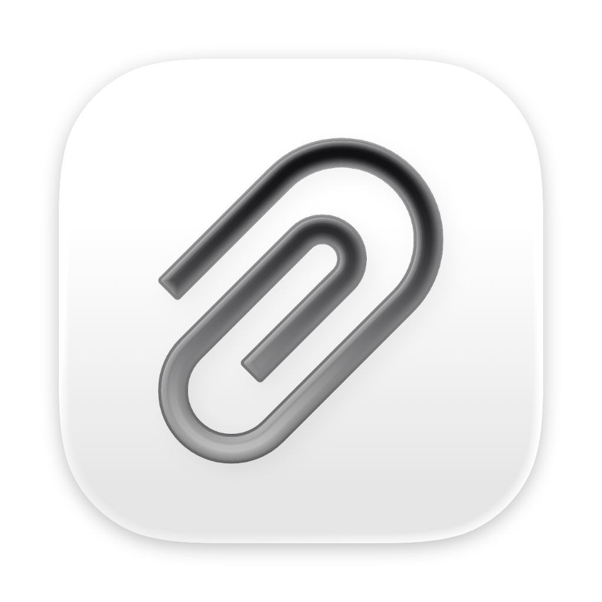
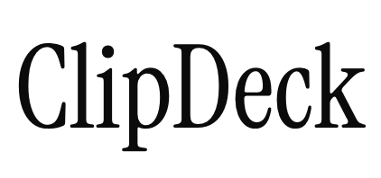

<h1 align="center">
  <picture>
    <source srcset="assets/icon-dark.png" media="(prefers-color-scheme: dark)" />
    
  </picture><br />
  <picture>
    <source srcset="assets/wordmark-dark.png" media="(prefers-color-scheme: dark)" />
    
  </picture>
</h1>

<p align="center"><em>Everything you copy is one shortcut away.</em></p>

<p align="center">
  <a href="https://github.com/nich227/ClipDeck/releases/latest"></a>
  <a href="https://github.com/nich227/ClipDeck/actions/workflows/test.yml"></a>
  
  
</p>

ClipDeck remembers everything you copy on your Mac, so you can use it again whenever you need it. Text keeps its formatting. Screenshots and images stay sharp, and files remain one click away. Press Shift-Command-C to open your clipboard history in a Liquid Glass panel over your work.

## Features

- ClipDeck keeps your entire history without a limit. Your history is available immediately, and search results appear as you type.
- ClipDeck returns each item the way you copied it. Rich text keeps its formatting. A screenshot returns as the same image, and a copied file returns as the same file.
- The panel appears over your work and never takes focus. Press Return to copy an item, and you're ready to paste.
- Click the paper clip to see your ten most recent items. Click one to copy it, or press Command-1 through Command-9 and Command-0 while the menu is open.
- After you copy, a small glass pill appears at the top of the screen with a checkmark and the item's name. It then slides away.
- Remove items from the last hour, the last day, or all history, by kind.
- Choose a maximum size in gigabytes. ClipDeck removes the oldest items automatically.
- ClipDeck uses your accent color and follows Light Mode and Dark Mode. Its icon follows the icon style you choose in System Settings.
- ClipDeck doesn't collect any data. Passwords copied from a password manager are never saved.
- When you first open ClipDeck, it asks for access to your Desktop, Documents, Downloads, and external drives, so it can show the files you copy from them. You can grant each one then, later, or never.

## Using ClipDeck

| To do this | Do this |
|---|---|
| Show or hide ClipDeck | Press Shift-Command-C. You can change the shortcut in ClipDeck Settings > General. |
| Search your history | Start typing. |
| Move through items | Press the Up Arrow or Down Arrow key. |
| Copy an item | Press Return, or double-click the item. |
| Dismiss the panel | Press Escape, or click outside the panel. |
| Paste | Press Command-V in any app. |
| Copy a recent item from the menu bar | Click the paper clip in the menu bar, then choose an item. Or press Command-1 through Command-9 for the first nine items and Command-0 for the tenth. |
| Clear your history | Click the paper clip, then choose Clear History. |
| Limit how much ClipDeck stores | Choose ClipDeck Settings > History, then turn on Limit Storage. |
| Check for updates | Click the paper clip, then choose Check for Updates. |

ClipDeck copies items to the Clipboard so you can paste them. It never pastes for you, so it doesn't need Accessibility access.

## Privacy

ClipDeck doesn't collect any data. It stores your clipboard history in your Library folder, where you can delete it at any time. It never saves items that password managers mark as sensitive. ClipDeck checks for updates automatically. You can turn this off in ClipDeck Settings > About.

## How ClipDeck stores your history

ClipDeck keeps your history in `~/Library/Application Support/ClipDeck/`:

| Location | Contents |
|---|---|
| `clipdeck.sqlite` | Every item, the original formats of each text item, links to copied files, the search index, and a running count of the storage in use |
| `blobs/` | Image data and other binary content, named by SHA-256 hash |
| `thumbs/` | A thumbnail for each image and file, created once in the background |

- ClipDeck stores text in every format it was copied in, up to 50 MB per item.
- ClipDeck stores files as links. It remembers where each file is and follows it if you move it. If ClipDeck can't find a file, it says so. Pressing Return copies the file's path.
- ClipDeck stores images as the image data you copied. It stores TIFF images as PNG and converts them back when you paste into an app that requires TIFF.
- Copying the same item again moves it to the top of your history instead of adding a duplicate.
- When Limit Storage is on, ClipDeck counts text, image data, and thumbnails toward the limit. When your history reaches the limit, ClipDeck removes the oldest items in batches. It always keeps the most recent item.
- Clearing your history removes the items you chose and only the files that belonged to them.
- After ClipDeck quits unexpectedly, it checks for leftover files and recounts the storage in use the next time it opens.

ClipDeck checks the Clipboard every 300 milliseconds by comparing a single counter. It pauses while your Mac is asleep or your screen is locked. The panel loads 100 items at a time, so it opens just as quickly with 100,000 items as with 10.

## Requirements

- macOS 26 or later
- To build ClipDeck, you need Xcode 26 or later and [XcodeGen](https://github.com/yonaskolb/XcodeGen) (`brew install xcodegen`)

## Building ClipDeck

```bash
xcodegen generate
xcodebuild -project ClipDeck.xcodeproj -scheme ClipDeck -configuration Debug -derivedDataPath build/DerivedData build
open build/DerivedData/Build/Products/Debug/ClipDeck.app
```

To run the tests:

```bash
xcodebuild -project ClipDeck.xcodeproj -scheme ClipDeck -configuration Debug -derivedDataPath build/DerivedData test
```

`scripts/build.sh`, `scripts/test.sh`, and `scripts/smoke-test.sh` run these commands for you. XcodeGen generates the Xcode project from `project.yml` but the repository doesn't include it.

ClipDeck uses Swift Package Manager for its dependencies. [Lottie](https://github.com/airbnb/lottie-ios) plays the animations. [Sparkle](https://github.com/sparkle-project/Sparkle) delivers updates. `scripts/make-animations.py` generates the animation files, and the script defines their geometry.

## Releasing ClipDeck

Push a tag such as `v1.2.0` to run `.github/workflows/release.yml`. The workflow builds ClipDeck, signs it with a Developer ID, and notarizes it. It creates a zip archive and a disk image. It then signs the archive for Sparkle. It publishes a GitHub Release and adds the release to the appcast on the `gh-pages` branch. Installed copies of ClipDeck check that appcast for updates.

The workflow uses these repository secrets: `MACOS_CERTIFICATE_P12` and `MACOS_CERTIFICATE_PASSWORD` for the Developer ID certificate. It uses `APPLE_API_KEY_P8`, `APPLE_API_KEY_ID`, and `APPLE_API_ISSUER` for notarization. It uses `SPARKLE_ED_PRIVATE_KEY`, the base64 seed that matches `SUPublicEDKey` in `ClipDeck/Info.plist`. The repository does not contain any key or certificate, and `.gitignore` excludes the common file types. Release notes go in `docs/release-notes/<version>.md` and appear in the GitHub Release and in the update window.

To release from your Mac, run `scripts/package.sh <version>`. It signs with the Developer ID in your keychain and notarizes through the Apple Account you're signed in to in Xcode. You don't need to enter a password or set up a key. This method notarizes the app but not the disk image. The app inside the disk image is notarized and stapled, so it opens without a warning. To notarize the disk image as well, pass `--notarize <profile>` with a `notarytool` keychain profile.

## License

ClipDeck is available under the MIT License. See [LICENSE](LICENSE).

The app icon and menu bar icon use `PaperClipOutlined` from [Ant Design Icons](https://github.com/ant-design/ant-design-icons), under the MIT License. The wordmark uses [Instrument Serif](https://github.com/Instrument/instrument-serif) by Rodrigo Fuenzalida and Jordan Egstad, under the SIL Open Font License. [Lottie](https://github.com/airbnb/lottie-ios) is licensed under Apache 2.0. [Sparkle](https://github.com/sparkle-project/Sparkle) is licensed under the MIT License. The [licenses/](licenses/) folder contains each license.

© 2026 Kevin Chen.
